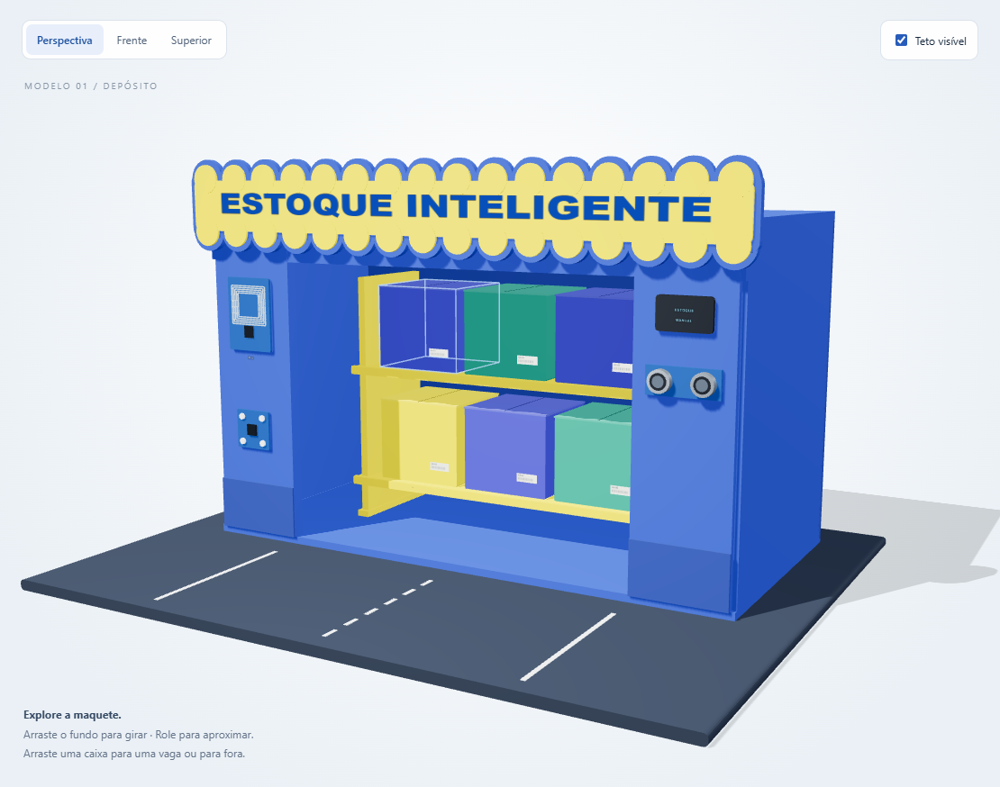

# Estoque Inteligente · Mundo SENAI

ESP32 + RFID + servidor local + maquete 3D. As tags dentro das seis caixas identificam os itens; o painel registra entrada, saída e mudança de vaga.



## O que está pronto

- Firmware para **ESP32 clássico WROOM/DevKit**, com RC522, HC-SR04, sensor de cor TCS3200 e OLED SPI.
- Servidor Node.js, sem dependências de produção, com persistência em disco e autenticação separada para painel e ESP32.
- Cadastro das seis tags, operações confirmadas por RFID, histórico, correção manual auditada e estado enviado ao navegador por SSE.
- Modelo 3D reconstruído das fotos, com modo conectado e demonstração manual independente.
- Documentação de montagem, configuração, calibração, API e testes.

**Limite do hardware:** um RC522 identifica uma tag próxima à sua antena. O HC-SR04 mede a presença na estação de leitura. Esses componentes não medem automaticamente as seis vagas. A vaga é escolhida pelo operador; o 3D mostra o estoque **registrado**, que deve ser conferido com a maquete. A cor é informação complementar, nunca a identidade da caixa.

## Começar no computador

Instale [Node.js 24](https://nodejs.org/en/download), abra um terminal na pasta do projeto e execute:

```sh
npm run setup
npm start
```

Abra **http://localhost:3000**. O comando `setup` cria `.env` com duas chaves aleatórias. Abra esse arquivo e use `ADMIN_TOKEN` para entrar no painel. Não há instalação de pacotes obrigatória para executar o servidor; `npm ci` é opcional e reproduz o lockfile.

O servidor escuta a rede local na porta 3000. O ESP32 e o computador precisam alcançar um ao outro pelo Wi-Fi. No firmware, use o IP do computador, por exemplo `http://192.168.1.100:3000`, **não localhost**.

Para explorar apenas o 3D, abra `public/demo.html` diretamente no navegador, sem servidor. Essa demonstração não altera o estoque conectado.

## Montar e gravar o ESP32

1. Leia [Montagem e pinagem](docs/MONTAGEM.md) antes de ligar a alimentação. A pinagem foi revisada e difere do documento original.
2. Instale a extensão [PlatformIO IDE](https://docs.platformio.org/en/latest/integration/ide/vscode.html) no VS Code.
3. Abra a pasta `firmware` no PlatformIO.
4. Copie `include/config.example.h` para `include/config.h` e preencha Wi-Fi, `SERVER_URL`, `DEVICE_TOKEN` e `DEVICE_ID`.
5. Clique em **Build**, depois **Upload**. Abra o monitor serial em **115200 baud**.
6. Com o servidor iniciado, confirme “ESP32 conectado” no painel.

Também é possível usar o terminal do PlatformIO na raiz do repositório:

```sh
pio run -d firmware
pio run -d firmware -t upload
pio device monitor -b 115200
```

O OLED fotografado tem **seis pinos SPI**, sem RESET exposto. O projeto usa `OLED_RESET_PIN = -1`. O modelo do controlador foi assumido SSD1306 128×64 com base no documento anterior; se o módulo real usar outro controlador, adapte a biblioteca.

## Cadastrar e usar

1. Comece com o cadastro vazio do sistema. O modelo conectado inicia com as seis caixas **fora** das vagas, pois as fotos não comprovam o estado físico atual.
2. Aba **Tags**: apresente uma caixa na estação, clique em **Usar última leitura**, escolha CX-01 a CX-06 e vincule a tag.
3. Retire a caixa por aproximadamente um segundo antes de apresentar a próxima. Repita para as seis tags.
4. Aba **Operar**: selecione a caixa, a operação e a vaga. Clique em **Preparar leitura RFID**.
5. Aguarde a operação aparecer no OLED, depois apresente a caixa na estação. A leitura da tag correta confirma o registro, atualiza o 3D e aparece no histórico.
6. Posicione fisicamente a caixa na vaga escolhida, ou retire-a da maquete no caso de saída.

Vagas A1–A3 = prateleira superior, da esquerda para a direita; B1–B3 = inferior. Uma operação expira em 60 segundos. A leitura de outra caixa, uma vaga ocupada e eventos repetidos não duplicam o movimento.

## Documentação

- [MONTAGEM.md](docs/MONTAGEM.md): componentes, alimentação, tabela de fios, divisor e estação física.
- [INSTALACAO.md](docs/INSTALACAO.md): servidor, rede, gravação e primeiro uso.
- [CALIBRACAO.md](docs/CALIBRACAO.md): distâncias, cores e diagnóstico.
- [ARQUITETURA-API.md](docs/ARQUITETURA-API.md): protocolo, persistência e integração do 3D.
- [TESTES.md](docs/TESTES.md): validação de software e roteiro para a bancada.
- [Manual imprimível](docs/Manual-de-montagem.pdf).

## Testar sem hardware

```sh
npm test
npm run simulate -- --watch
```

O segundo comando representa um ESP32 fictício para testar a comunicação. Em outro terminal:

```sh
npm run simulate -- --uid 04A1B201
```

O UID é apenas exemplo. Na aba Tags, vincule esse UID à CX-01. Prepare uma entrada e execute novamente o comando com `--uid`. O teste usa a mesma API do ESP32. Pare o simulador antes de usar a placa real: ambos representam o mesmo dispositivo. Não misture dados simulados com uma apresentação real; faça as correções de posição pelo painel.

## Pastas

```text
server/       API HTTP, autenticação, persistência e SSE
public/       painel, 3D conectado, demonstração e bibliotecas locais
firmware/     PlatformIO, código C++ e configuração de exemplo
docs/         instruções e manual PDF
assets/       modelo GLB e prévia
referencias/  fotos, vídeo e DOCX originais fornecidos pelo grupo
scripts/      configuração e simulador de dispositivo
test/         testes automatizados
data/         estado criado localmente (ignorado no Git)
```

## Estado da entrega

A validação de software está descrita em [TESTES.md](docs/TESTES.md). Não houve gravação nem teste na placa física do grupo. Calibração, pinagem da placa específica e funcionamento dos módulos precisam ser conferidos na bancada.

O servidor foi pensado para uma rede local confiável durante o projeto. O protocolo padrão é HTTP; não exponha a porta diretamente à internet. `.env`, `config.h` e `data/` não são enviados ao Git. Faça backup de `data/state.json` com o servidor parado. Bibliotecas 3D mantêm sua licença em `public/vendor/LICENSE-THREE.txt`.
