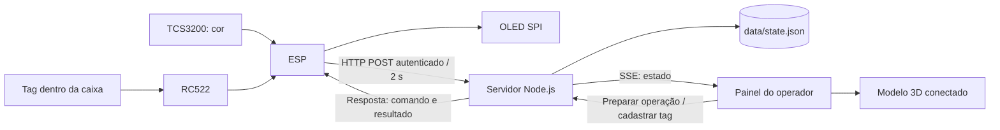

# Arquitetura e protocolo



## Modelo de estoque

Há seis caixas, cada uma com `id`, `color`, `uid` e `slot`. Uma caixa está em A1–A3, B1–B3 ou `null` (fora). IDs virtuais são CX-01 a CX-06. A CX-02 foi identificada pelo grupo como amarela; as demais cores iniciais vêm da maquete de referência e podem precisar de conferência. O UID é cadastrado pelo operador, não inventado pelo software.

A ocupação é derivada dessas posições. Não existe um contador separado que possa divergir. O servidor é a fonte do estado; o modelo conectado não aceita mudanças por arraste. A demonstração manual em `/demo.html` é independente.

## Transação física e digital

Sem comando manual ativo, a leitura de uma tag cadastrada inicia uma entrada;
após cerca de dois segundos a caixa é guardada na primeira vaga virtual livre.
Uma nova leitura da caixa guardada registra a saída. Essa vaga não é detecção
automática da posição física.

1. Operador seleciona caixa, ação e vaga livre.
2. Servidor cria um comando único, válido por 60 segundos.
3. ESP32 recebe o comando na resposta do próximo relatório e mostra a operação no OLED.
4. O leitor RFID lê a tag apresentada. O firmware gera um `eventId` aleatório e guarda esse evento na NVS.
5. Servidor confere comando, prazo, UID esperado e disponibilidade da vaga; grava o estado e responde.
6. ESP32 remove o evento pendente somente após resposta válida. Navegadores recebem o estado por SSE.

O registro não prova que alguém colocou a caixa na vaga indicada; essa etapa é física e manual. Não há localização automática por prateleira, motor ou atuador neste projeto.

## Autenticação

- Dispositivo: `Authorization: Bearer DEVICE_TOKEN`.
- Painel: `POST /api/login` com a chave ADMIN_TOKEN; sessão por cookie HttpOnly/SameSite Strict. Para ferramentas locais de teste, endpoints administrativos também aceitam Bearer ADMIN_TOKEN.
- As duas chaves devem ser diferentes e ter pelo menos 32 caracteres; `npm run setup` gera 64 caracteres hexadecimais por chave.
- Sem CORS permissivo. Requisições de escrita com `Origin` diferente do host são rejeitadas.
- Limite de 16 KiB por corpo JSON e limite de tentativas inválidas de login por IP.
- HTTP sem criptografia por padrão; adequado apenas à rede confiável da demonstração. Não é um serviço pronto para exposição pública.

## API administrativa

| Método e rota | Função / corpo |
|---|---|
| GET `/api/health` | Estado básico do servidor; público |
| POST `/api/login` | `{ "token": "ADMIN_TOKEN" }` |
| POST `/api/logout` | Encerra sessão |
| GET `/api/state` | Snapshot autenticado do estoque |
| GET `/api/events` | SSE autenticado, evento `data:` com snapshot |
| POST `/api/tags` | `{ "boxId":"CX-01", "uid":"04A1B201" }` |
| POST `/api/command` | `{ "action":"entrada", "boxId":"CX-01", "slot":"A1" }` |
| DELETE `/api/command` | Cancela operação pendente |
| POST `/api/reconcile` | `{ "boxId":"CX-01", "slot":null, "reason":"Retirada sem leitura" }` |

Ações: `entrada`, `saida`, `mover`. Em saída, slot é `null`. O servidor não aceita duas operações pendentes simultâneas. Para alterar a tag de uma caixa já no estoque, retire-a primeiro. A correção manual exige motivo e cancela a operação pendente.

## Relatório do ESP32

`POST /api/device/report`, com chave de dispositivo e `Content-Type: application/json`:

```json
{
  "deviceId": "esp32-maquete-01",
  "telemetry": {
    "present": true,
    "distanceCm": null,
    "color": "azul",
    "rssi": -52,
    "pulses": [120, 140, 80],
    "rfidOk": true,
    "oledOk": true
  },
  "scan": {
    "eventId": "exemplo-00000001",
    "uid": "04A1B201",
    "commandId": "id-recebido-do-servidor"
  }
}
```

Os valores são exemplos. Sem leitura nova, omita `scan`. `present` indica uma tag recentemente detectada no leitor, e não ocupação de vaga; `distanceCm` é sempre `null`. Sem comando, `commandId` é `null`. `pulses` contém durações R/G/B em microssegundos, não frequências. Cor aceita `azul`, `verde`, `vermelho`, `amarelo`, `indefinida`.

Resposta:

```json
{
  "ok": true,
  "serverTime": 1792620000000,
  "result": {"accepted": true, "code": "applied", "message": "CX-01 entrada OK", "boxId": "CX-01", "slot": "A1"},
  "command": null
}
```

`result` é `null` sem scan. Um comando contém `id`, `action`, `boxId`, `slot`, `createdAt` e `expiresAt`, em milissegundos Unix para os tempos. O firmware usa `expiresAt - serverTime` para calcular o prazo sem depender de relógio/NTP.

Resultados de leitura incluem `applied`, `observed`, `unknown_tag`, `expired`, `stale_command`, `wrong_box` e `conflict`. Rejeições de negócio ainda recebem HTTP 200 com `accepted:false`, permitindo encerrar o evento sem repetição infinita. Falha de autenticação ou JSON inválido usa 4xx e `{"error":"..."}`.

## Persistência e falhas

O servidor é de processo único. As transações de estoque são síncronas e salvam um arquivo temporário antes de substituir `state.json`. Uma falha de escrita restaura o estado em memória e não confirma a operação. Isso reduz estados parcialmente gravados; não constitui garantia contra toda falha elétrica do computador. Faça backups.

- 200 registros de histórico e 1000 recibos de eventos são mantidos.
- Reenvios com o mesmo `eventId` devolvem o resultado salvo; não repetem o movimento.
- Se um evento muito antigo cair fora do histórico de deduplicação, seu comando consumido/expirado não pode executar novamente.
- Um reinício cancela comandos pendentes e exige nova telemetria para declarar o dispositivo online.
- O navegador considera o ESP32 offline após dez segundos sem relatório e para de apresentar a telemetria antiga como atual.
- NVS guarda apenas uma leitura pendente no ESP32. Reenvio não equivale a uma fila de movimentações offline.
- HTTP é feito com timeouts curtos. Leituras dos sensores e atualizações do OLED podem atrasar durante uma tentativa de rede; não é um sistema de tempo real rígido.

## Interface do modelo

O painel carrega `/model/?live=1&embed=1` em iframe da mesma origem e chama:

```js
iframe.contentWindow.maquete.atualizarEstado({
  version: 1,
  boxes: [{ id: "CX-01", slot: "A1" } /* todas as seis caixas */]
});
```

Essa função valida IDs e unicidade de vagas, sincronizando a posição sem escrever no armazenamento da demonstração. Os grupos do GLB são `Estrutura`, `Estante`, `Sensores_visuais`, `Caixas` e `Vagas`; caixas CX_01–CX_06 e pontos Vaga_A1–Vaga_B3 são independentes. A escala é nominal e não serve como desenho de fabricação.
