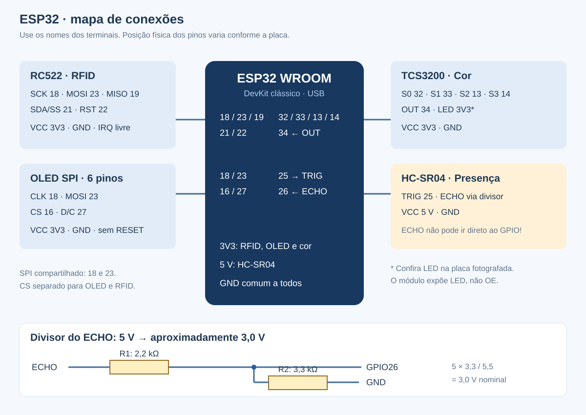

# Montagem física e ligações

## 1. Conferência das peças

As fotografias enviadas mostram:

| Peça | Identificação / observação |
|---|---|
| Leitor RFID | Placa RC522 / MFRC522, comunicação SPI |
| Ultrassônico | HC-SR04, dois transdutores e quatro terminais |
| Sensor de cor | Placa “Color Sensor V443”, família TCS3200 conforme o documento; LEDs e dois cabeçalhos |
| OLED | Seis terminais rotulados VCC, GND, CLK, MOSI, CS, D/C; interface SPI |
| Etiquetas | O grupo confirmou uma tag dentro de cada caixa |
| Controlador | ESP32 informado pelo grupo; variante não visível nessas fotos |

O firmware é para **ESP32 clássico WROOM/DevKit**. Não transfira esta pinagem diretamente para ESP32-C3, S2 ou S3. A placa escolhida deve expor os GPIOs da tabela. O controlador do OLED é tratado como SSD1306 128×64, conforme a documentação fornecida; a fotografia sozinha não confirma o chip.

Materiais adicionais: protoboard, jumpers, cabo USB **de dados**, alimentação USB estável, resistor **2,2 kΩ** e resistor **3,3 kΩ** (preferencialmente 1%) para o ECHO. Verifique a presença desses resistores: não foram identificados nas fotos. Etiquetas precisam ser compatíveis com RC522, normalmente ISO/IEC 14443 A / MIFARE / NTAG de 13,56 MHz, e ter UIDs distintos.

## 2. Alimentação

Faça as conexões **com o USB desconectado**.

- ESP32: alimentação pelo USB da placa de desenvolvimento.
- RC522: **3V3**, nunca 5 V.
- OLED: **3V3** neste projeto, com os sinais SPI em 3,3 V.
- TCS3200: **3V3** neste projeto, para manter OUT compatível com o ESP32. O chip suporta 2,7–5,5 V; o módulo e seus LEDs precisam ser verificados na bancada. Se os LEDs ficarem fracos, calibrem com iluminação externa estável. Não mude para 5 V sem adaptar os níveis lógicos.
- HC-SR04: **5 V** da linha USB/VIN da placa, se o fabricante da sua DevKit confirmar esse pino como linha de 5 V quando alimentada por USB. Caso contrário, use fonte 5 V regulada para o sensor, mantendo GND comum.
- Todos os GND devem estar ligados entre si. Confira se os trilhos da protoboard são interrompidos no meio.
- Não alimente o mesmo circuito por fontes distintas em paralelo sem conhecer o circuito de alimentação da placa. Não injete 5 V em GPIO ou no pino 3V3.

## 3. Tabela única de conexões

Os números são **GPIO**, não a posição física do terminal. Siga os rótulos impressos nos módulos; a ordem visual pode mudar entre fabricantes.

| Módulo | Terminal | Ligação no ESP32 / circuito |
|---|---|---|
| OLED SPI | VCC | 3V3 |
| OLED SPI | GND | GND |
| OLED SPI | CLK / D0 | GPIO18, compartilhado com SCK do RC522 |
| OLED SPI | MOSI / D1 | GPIO23, compartilhado com MOSI do RC522 |
| OLED SPI | CS | GPIO16 |
| OLED SPI | D/C / DC | GPIO27 |
| OLED SPI | RESET | Não existe exposto na foto: `OLED_RESET_PIN=-1` |
| RC522 | 3.3V | 3V3 |
| RC522 | GND | GND |
| RC522 | SCK | GPIO18 |
| RC522 | MOSI | GPIO23 |
| RC522 | MISO | GPIO19 |
| RC522 | SDA / SS | GPIO21 (CS do SPI; não é I²C) |
| RC522 | RST | GPIO22 |
| RC522 | IRQ | Sem conexão |
| HC-SR04 | VCC | 5 V |
| HC-SR04 | GND | GND |
| HC-SR04 | TRIG | GPIO25 |
| HC-SR04 | ECHO | Divisor abaixo → GPIO26 |
| TCS3200 | VCC | 3V3 |
| TCS3200 | GND | GND |
| TCS3200 | S0 | GPIO32 |
| TCS3200 | S1 | GPIO33 |
| TCS3200 | S2 | GPIO13 |
| TCS3200 | S3 | GPIO14 |
| TCS3200 | OUT | GPIO34 (somente entrada) |
| TCS3200 | LED | 3V3 para habilitação no módulo mostrado; confirme o comportamento na bancada |

A placa de cor fotografada tem VCC e GND repetidos nos cabeçalhos. Use uma alimentação comum de 3,3 V; não misture tensões nesses pinos. Se houver um módulo diferente com OE, confirme sua folha de dados antes de conectá-lo; a placa fotografada expõe **LED**, não OE.

OLED e RC522 compartilham apenas CLK e MOSI. Cada um tem seu próprio CS. Use fios curtos, preferencialmente até aproximadamente 15–20 cm para o SPI durante os primeiros testes.

## 4. Divisor obrigatório do ECHO

```text
HC-SR04 ECHO (5 V) ─── R1 2,2 kΩ ───┬─── GPIO26
                                    │
                                 R2 3,3 kΩ
                                    │
                                   GND
```

A junção dos dois resistores vai ao GPIO26. R1 está entre ECHO e a junção; R2 entre a junção e GND. Com ECHO em 5 V, a junção fica nominalmente em **3,0 V**: `5 × 3,3 / (2,2 + 3,3)`. O divisor é no ECHO, não no VCC. Não ligue ECHO diretamente ao ESP32. O sinal TRIG de 3,3 V é aceito pelo HC-SR04 descrito na referência da Adafruit.



## 5. Estação de leitura

Nas fotos, os sensores aparecem em lados diferentes da fachada. Para que ultrassônico e RFID observem **a mesma caixa**, monte uma pequena estação de leitura à frente do depósito:

1. Fixe o RC522 sob uma base fina de papelão ou ao lado da caixa. A tag dentro da caixa deve ficar próxima e aproximadamente paralela à antena do leitor. Teste a distância real; não conte com leitura através de toda a estante.
2. Coloque o HC-SR04 apontado para uma face plana da caixa. Use um batente para posicioná-la inicialmente a aproximadamente **3 cm** do sensor. A configuração reconhece presença abaixo de 4 cm e libera acima de 6 cm, com filtragem de leituras.
3. Aponte o sensor de cor para uma área colorida uniforme da mesma caixa. Comece com distância curta, aproximadamente 1–2 cm, e ajuste conforme a resposta do módulo. Uma pequena cobertura ajuda a manter a luz constante.
4. Deixe o OLED visível na fachada. O ESP32 e a protoboard podem ficar atrás, com acesso ao USB.
5. Marque A1, A2, A3 na prateleira superior e B1, B2, B3 na inferior, da esquerda para a direita vistas de frente.

O ultrassônico reconhece a **estação**, não a ocupação das vagas. Após confirmar uma entrada, coloque fisicamente a caixa na vaga escolhida. Se alguém mudar uma caixa sem registrar, use a correção manual auditada e confira a maquete.

## 6. O que mudou em relação ao DOCX original

| Sinal | Documento anterior | Firmware deste repositório |
|---|---|---|
| OLED CS | GPIO4 | GPIO16 |
| RC522 CS | GPIO12 | GPIO21 |
| RC522 RST | GPIO14 | GPIO22 |
| HC-SR04 TRIG | GPIO15 | GPIO25 |
| TCS S2 | GPIO25 | GPIO13 |
| TCS S3 | GPIO13 | GPIO14 |

As mudanças evitam depender de GPIO12 e GPIO15 durante o boot do ESP32 clássico e separam os sinais sem conflitos. O GPIO34 continua sendo usado somente como entrada. **Não misture a tabela antiga com o novo firmware.** O arquivo original está preservado em `referencias/` e não foi alterado.

## 7. Referências técnicas

- [Espressif: datasheet ESP32](https://documentation.espressif.com/esp32_datasheet_en.html) — pinos, limites elétricos e strapping.
- [NXP: MFRC522](https://www.nxp.com/docs/en/data-sheet/MFRC522.pdf) — interface RFID e alimentação.
- [Adafruit: HC-SR04, pinagem e ECHO de 5 V](https://learn.adafruit.com/ultrasonic-sonar-distance-sensors/pinouts).
- [ams OSRAM: TCS3200](https://ams-osram.com/products/sensor-solutions/ambient-light-color-spectral-proximity-sensors/ams-tcs3200-color-sensor) — chip e faixa de alimentação; não substitui a conferência da placa genérica.
- [Adafruit SSD1306](https://github.com/adafruit/Adafruit_SSD1306) — display SPI e reset opcional.

As imagens identificam os módulos, mas não certificam o circuito interno de cada placa genérica. As ligações foram projetadas e documentadas; a montagem física ainda precisa ser testada pelo grupo.
